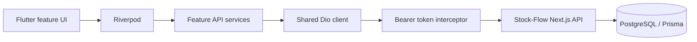

# Stock-Flow Mobile

Flutter mobile and web client for the existing Stock-Flow inventory platform. It uses the Next.js REST API as its backend; the Flutter app does not connect directly to PostgreSQL.

## 1. Project overview

Stock-Flow Mobile helps authorized staff manage a product catalog, purchases, and sales from Android, iOS, and Flutter Web. Authentication and business permissions are provided and enforced by the existing Stock-Flow backend.

## 2. Features

- Email/password sign-in, session restoration, and sign-out.
- Product search, category and stock-status filters, pagination, create/edit, and admin-only activate/deactivate actions.
- Category search and management.
- Purchase list and details, draft creation/editing/deletion, and completion.
- Sales list and details, search, date filtering, and sale creation.
- Role-aware navigation and actions.

The Home screen is a placeholder. Inventory summaries, stock adjustments, stock movement history, and reports are not implemented in the Flutter app yet. See the [user guide](docs/user-guide.md) for current role behavior and limitations.

## 3. Screenshots

Screenshots are not checked into this repository yet. Add current app captures under `docs/screenshots/` and embed them here when available; the generated launcher icons are not application screenshots.

## 4. Technologies used

| Area | Technology |
| --- | --- |
| Client | Flutter / Dart (`^3.13.2`) |
| HTTP | Dio (`^5.11.1`) |
| State and dependency injection | Riverpod (`flutter_riverpod ^3.4.3`) |
| Navigation | GoRouter (`^18.1.3`) |
| Secure token storage | Flutter Secure Storage (`^11.2.0`) |
| Backend | Existing Next.js 16 REST API, Better Auth bearer plugin |
| Backend data | PostgreSQL through Prisma |

## 5. Architecture overview

Feature-based modules separate screens, models, API services, and Riverpod providers. A shared Dio provider configures the API URL and bearer-token interceptor. GoRouter protects authenticated routes and uses an indexed stateful shell to retain tab stacks.



See [architecture.md](docs/architecture.md) for the module map, auth flow, and current integration boundaries.

## 6. Installation instructions

Prerequisites: Flutter with Dart 3.13.2 or newer, Chrome for the web workflow, Node.js/npm, and a reachable PostgreSQL database. Android builds require Android Studio/SDK; iOS builds require macOS and Xcode.

Install backend dependencies and prepare its database from the Flutter project root:

```powershell
cd ..\..\stock-flow
npm ci
npx prisma migrate deploy --config prisma7.config.ts
npx prisma generate --config prisma7.config.ts
```

Configure the backend `.env` with `DATABASE_URL` before migration. Then return to the Flutter project root and install Flutter packages:

```powershell
cd ..\mobile\stock-mobile
flutter pub get
```

See [setup.md](docs/setup.md) for seed-data precautions, physical-device networking, and complete prerequisites.

## 7. Environment configuration

| Setting | Used by | Purpose |
| --- | --- | --- |
| `API_BASE_URL` | Flutter `--dart-define` | Backend origin, for example `http://localhost:3000`; do not append `/api`. |
| `DATABASE_URL` | Backend `.env` | PostgreSQL connection string. |
| `MOBILE_WEB_ORIGIN` | Backend environment | Exact Flutter Web origin allowed by API CORS and Better Auth. Development defaults to `http://localhost:5173`. |

The app defaults to `http://10.0.2.2:3000` on Android emulators and `http://localhost:3000` on other targets. Override the URL for a physical device or deployed backend. Do not commit `.env` files, signing credentials, tokens, or passwords. `--dart-define` values are embedded in the app and are not secret storage.

## 8. How to run the project

Start the backend in one terminal:

```powershell
cd ..\..\stock-flow
npm run dev
```

Run Flutter Web in a second terminal at the Flutter project root. The port must remain `5173` unless `MOBILE_WEB_ORIGIN` is updated on the backend.

```powershell
flutter run -d chrome --web-port 5173 --dart-define=API_BASE_URL=http://localhost:3000
```

For an Android emulator:

```powershell
flutter devices
flutter run -d <emulator-id> --dart-define=API_BASE_URL=http://10.0.2.2:3000
```

## 9. How to run tests

```powershell
dart format lib
flutter analyze
flutter test
```

Current tests cover a dashboard smoke check, product JSON parsing, and a legacy workout-model calculation. They do not cover every screen or exercise the API against a live backend.

## 10. Deployment instructions

- **Web:** `flutter build web --release --dart-define=API_BASE_URL=https://<your-api-host>`; host `build/web` with an SPA fallback and set backend `MOBILE_WEB_ORIGIN` to the deployed web origin.
- **Android:** `flutter build appbundle --release --dart-define=API_BASE_URL=https://<your-api-host>`.
- **iOS:** On macOS with Xcode signing configured, run `flutter build ipa --release --dart-define=API_BASE_URL=https://<your-api-host>`.

The Android project still needs release preparation: add Internet permission to the main manifest, replace the template application ID, and configure release signing (the current release config uses the debug key). See [deployment.md](docs/deployment.md) before distributing a build.
