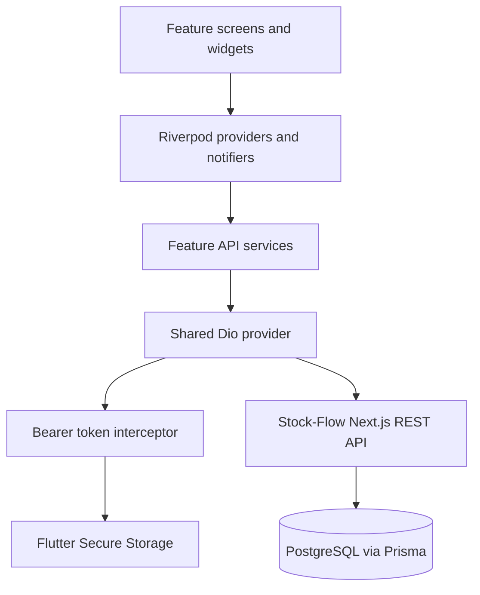

# Architecture

## Runtime shape

The Flutter app is a client of the existing Next.js API. PostgreSQL access and business rules remain in the backend; the Flutter app does not connect to the database directly.

## Application entry and routing

- `lib/main.dart` starts `StockFlowApp` inside `ProviderScope` and builds `MaterialApp.router`.
- `lib/core/router/app_router.dart` defines the router, auth redirects, and a `StatefulShellRoute.indexedStack` with Home, Products, Purchases, Sales, and Settings branches. Tabs retain their in-memory navigation state while switching branches.
- `/startup` waits for auth initialization. Unauthenticated users go to `/login`; protected routes return to login while preserving a safe intended destination. Purchases and Sales are hidden or redirected when the current role cannot access them.
- Product and purchase details are nested routes in their respective branches. Categories are nested under Settings.

## Network and authentication

- `lib/core/network/dio_client.dart` builds a single Dio instance with JSON headers and 10-second connect, send, and receive timeouts. `API_BASE_URL` can override the default. The default is `http://10.0.2.2:3000` for Android emulators and `http://localhost:3000` for other targets.
- `lib/core/network/dio_provider.dart` provides that shared Dio instance through Riverpod and adds `BearerTokenInterceptor`.
- The interceptor reads the Better Auth bearer token from `SecureStorage`, sends it as `Authorization: Bearer ...`, stores the `set-auth-token` response header, and clears the token and notifies auth state on a protected API 401.
- `lib/core/storage/secure_storage.dart` abstracts Flutter Secure Storage so application code does not access the plugin directly.
- `lib/core/network/api_exception.dart` translates Dio failures into readable messages. Feature services use Dio directly and own endpoint-specific JSON parsing.

## Features and state

Each implemented feature keeps its model, API service, provider, and screen together:

| Feature | Current implementation |
| --- | --- |
| Auth | `features/auth`: sign-in, session initialization, sign-out, and role model |
| Products | `features/products`: typed models, Dio service, `AsyncNotifierProvider`, list/detail/forms, filters, paging, activate/deactivate UI |
| Categories | `features/categories`: typed models, search provider, CRUD screen |
| Purchases | `features/purchases`: list/detail, draft mutations, completion, product picker |
| Sales | `features/sales`: list, date and text filters, creation, detail display |

Riverpod providers also inject feature API services. Async screen states use `AsyncValue` for loading, data, and errors. Product search is debounced in the screen; category, purchase, and sale queries are made through their API services.

## Current boundaries and gaps

- Home currently contains placeholder dashboard copy; the backend dashboard endpoint is not integrated.
- The backend has inventory, stock-adjustment, movement, and report APIs, but the Flutter app does not yet implement those screens or services.
- Product JSON parsing is handwritten; code generation for models is not configured.
- `lib/pages`, `lib/models/workout.dart`, and related workout files remain in the repository, but `main.dart` routes to the Stock-Flow app rather than those legacy pages.
- This is a feature-based application, not a strict clean-architecture implementation: there are no separate domain/repository layers. Add those only if the app's complexity warrants them.
